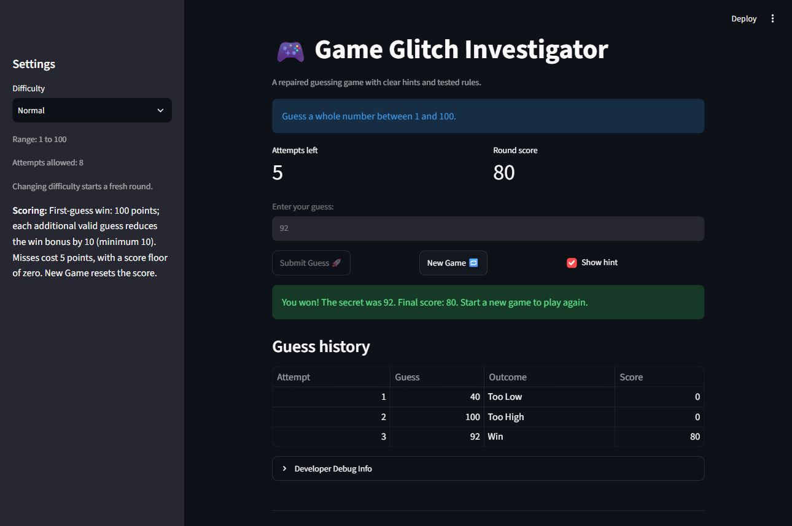

# Game Glitch Investigator

A repaired Streamlit number-guessing game for CodePath AI110 Project 1.
Guess the secret within the attempt limit, follow high/low hints, and see
the result and score for every valid guess.

## Setup

Use Python 3.10 or newer. From this repository on Windows:

```powershell
py -m venv .venv
.\.venv\Scripts\Activate.ps1
py -m pip install -r requirements.txt
py -m streamlit run app.py
```

Open the local URL printed by Streamlit. To run the tests:

```powershell
py -m pytest -q
```

Dependencies are pinned to the versions used for verification. Tests include
Streamlit AppTest sessions, which exercise the real app and its callbacks.

## Rules

| Difficulty | Inclusive range | Valid guesses allowed |
|---|---|---|
| Easy | 1–20 | 6 |
| Normal | 1–100 | 8 |
| Hard | 1–50 | 5 |

These ranges and limits are preserved from the starter. Empty input,
non-integers, and numbers outside the current range show an error without
using an attempt. A wrong guess costs five points, stopping at zero. A win
adds 100 points on the first valid guess, with ten fewer points for each
additional attempt and a minimum bonus of ten. Score is per round; New Game
and difficulty changes reset it, the history, input, status, and attempts.

## Document Your Experience

The starter mixed the UI and game rules in `app.py`, while `logic_utils.py`
contained unimplemented functions. It reversed hint directions, compared
numbers as strings on alternating turns, accepted truncated decimal inputs,
rewarded some misses, started the attempt count at one, and incompletely
reset rounds. Invalid inputs could push the counter past the limit while the
game stayed active; changing difficulty could leave the secret outside the
new range.

The repairs move four pure functions into `logic_utils.py`, preserve the
original three tests' outcome-string contract, and validate input before
updating state. In `app.py`, `submit_guess` processes one valid turn and
`start_new_game` resets a complete round. Callbacks update state before the
page renders, so counters and results show the current turn. Comparisons
remain numeric, hints agree with outcomes, and completed games disable
further guesses.

Furkan requested completion with Codex and chose to restart when earlier fixes
could not be located. Codex reproduced the failures, implemented these changes,
wrote and ran the tests, and prepared the documentation. The reflection
distinguishes those actions from Furkan's own decisions; it does not claim
he independently implemented or manually tested the code.

## Demo Walkthrough

This is the actual Chrome session run by Codex after the repairs. Its randomly
generated secret was **92**, read through the existing Developer Debug Info
expander. A fresh game will normally have a different secret.

1. Open Normal difficulty: range 1–100, eight attempts left, score zero.
2. Enter `abc` and click Submit Guess. The app says
   `Enter a whole number (for example, 42).` Eight attempts remain.
3. Enter `40`: `Too Low — go higher!` Seven attempts remain; score zero.
4. Enter `100`: `Too High — go lower!` Six attempts remain; score zero.
5. Enter `92`: `You won! The secret was 92. Final score: 80.` Five attempts
   remain, and further guesses are disabled. History lists 40, 100, and 92
   with the corresponding outcomes and scores.
6. To play again, click New Game. The automated end-to-end test verifies that
   this restores playing status, clears history/input, resets score and attempts,
   and chooses a new secret inside the selected difficulty range.



The test suite also plays a deterministic 40 → 70 → 50 game with secret 50,
loses after exactly eight wrong Normal guesses, and wins on the last allowed
attempt. See `tests/test_app.py`.

## Test Results

Actual run on October 10, 2026 (EDT), using `py -X utf8 -m pytest -q`:

```text
.................................                                        [100%]
33 passed in 11.30s
```

All three original starter tests are unchanged and pass. The additional tests
cover empty/whitespace input, non-numeric input, decimal input, negative and
out-of-range input, inclusive boundaries, numeric comparisons, scoring,
win/loss/restart behavior, difficulty changes, and unrelated widget reruns.
The output is also saved in [test_results.txt](test_results.txt).

## Evidence and AI Collaboration

- [reflection.md](reflection.md): bug reproduction table, causes, AI feedback,
  and an honest account of contributions.
- [starter_reproduction.txt](starter_reproduction.txt): actual pre-fix runs.
- [starter_test_results.txt](starter_test_results.txt): three failing starter tests.
- [ai_interactions.md](ai_interactions.md): actual request, agent workflow,
  and edge-case test rationale.
- `tools/reproduce_starter.py`: replay the original bugs from upstream commit
  `f651d72` with `py -X utf8 tools/reproduce_starter.py`. This uses Git history;
  it intentionally runs the original buggy source, not the repaired app.

## UI Enhancements

`app.py` adds visible attempts/score metrics, persistent result messages,
directional hints with text and icons, and a guess-history table. The history
records each valid guess, outcome, and resulting score. Disabled controls make
completed rounds clear, and range/scoring instructions explain the game rules.
The Developer Debug Info expander remains available for this learning project;
opening it reveals the secret.

No second-model comparison or student-led manual testing is claimed.
This project has been prepared for review; the CodePath submission action
was not performed.
